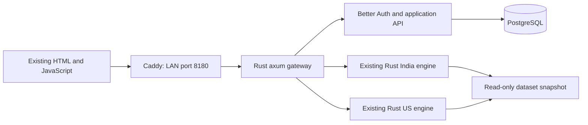

> React migration: the production frontend now builds from `../frontend/react`. See the root README and `docs/DEVELOPMENT.md` for branch rules, active entry points and external data setup. Historical verification notes below describe the prior HTML interface where stated. No datasets or private runtime credentials are included in Git.

# Strategy Vault full-stack app

This version keeps the existing Full Variant 1 HTML/JavaScript interface, including its stats cards, fonts, charts, automatic conclusions and CSV/Excel exports. An axum gateway serves it at one authenticated address. Better Auth handles accounts and sessions, and PostgreSQL stores users, roles, research conclusions, revision history, themes and the last research view. Both market engines reuse the existing Rust strategy source. Publishing now requires data-readiness checks; unsupported options calculations are withheld.

The user explicitly chose to keep the existing interface on 08-10-2026. The first CEO changes now enforce data readiness, separate computed results from book figures and color arrows by trading action. A React port and the remaining CEO roadmap remain later work. The 2026-10-09 update adds native AmiBroker cash-stock imports and the requested report controls; see the basket/report section below.



## Run

From this folder:

```bash
bash scripts/start.sh
```

Open **http://192.168.4.30:8180** from this PC or the same LAN. The first administrator's email and generated password are in `~/.cache/strategy-vault-webapp/administrator.txt`. Account creation is available through **Accounts** after signing in. Public registration is disabled.

Setup creates secrets in `~/.cache/strategy-vault-webapp/.env` with owner-only permissions and retains them on subsequent runs. The workspace `.env` records only the runtime location. Docker's daemon cannot read the SMB/FUSE share directly; setup stages the selected India/US datasets and original notes on local disk. It leaves all source market files in their original locations. Set `VAULT_RUNTIME_ROOT` before running setup to choose another local directory.

Images build sequentially with at most two Cargo jobs. The two engines share a two-core CPU affinity and each has a 1 GiB memory limit. The gateway admits one optimization across both markets, bounds numeric input and result size, and admits at most four ordinary engine calls at a time. Ordinary calls queue briefly; a second optimization receives HTTP 429 with a retry delay. Existing optimization limits remain 50,000 combinations and 1,000 values per parameter. Optimization remains a synchronous request; durable jobs, cancellation and worker recovery are future work.

The build can use this machine's trusted certificate through a BuildKit secret. TLS verification stays enabled. All internal services are private to the Compose network; only Caddy's port is published. Docker restart policies restart these services when Docker starts again.

## Access levels

| Role | Read and run strategies | Optimize and save conclusions | Manage accounts |
|---|---|---|---|
| Viewer | Yes | No | No |
| Researcher | Yes | Yes | No |
| Administrator | Yes | Yes | Yes |

Themes and the last research view are individual account preferences. Conclusions are shared company research, keyed by the existing strategy/market identifiers, and each save records its author and a revision. Existing text notes import once and never overwrite a database conclusion on restart. The India/US notes routes retain the old text request/response contract while storing content in PostgreSQL.

Session cookies are HttpOnly and SameSite=Lax. HTTPS deployments use Secure cookies. Writes require a configured origin. Caddy replaces the client-IP header before forwarding it, so login throttling uses the trusted address. The gateway checks sessions before exposing engine data or private application files. Account roles cannot be chosen by public signup or user profile updates.

## Code locations

| Responsibility | Location |
|---|---|
| Existing interface and charts | `../frontend/full-variant1.html` |
| Existing optimization and exports | `../frontend/optim.js`, `../frontend/optim-core.js` |
| Runtime selection between legacy and authenticated URLs | `../frontend/app-runtime.js`, gateway static route |
| Login, account controls, administration pages | `public/` |
| Rust gateway, authentication checks, resource limits | `gateway/src/main.rs`, `gateway/src/policy.rs` |
| Better Auth, users, settings and conclusions API | `auth/src/` |
| Database schema and migrations | `db/001-app.sql`, Better Auth migration bootstrap |
| Existing calculation engine and publishing checks | `../backend/src/`, including `readiness.rs` |
| Shared result labels, book references and action markers | `../frontend/backtest-trust.js` |
| Readiness API/browser checks and chart-input consistency | `tests/data_readiness.py`, `tests/chart_data_audit.py` |
| Service deployment and resource limits | `compose.yaml`, `infra/` |
| Setup, start, backup and verification commands | `scripts/` |

The frontend makes engine requests to `/api/in/...` and `/api/us/...`. User data uses `/api/app/...`; authentication uses `/api/auth/...`. The legacy static preview retains its direct-engine URLs through the runtime flag.

## Verification

```bash
bash scripts/verify.sh
```

Verification requires Node 24, Cargo, Python Playwright, Poppler (pdfinfo/pdftotext) and Google Chrome on the development machine; deployed containers do not require these host tools. It exercises permissions, origin checks, database persistence, input validation, both engine APIs, the optimization concurrency limit, the actual browser flows and exported files. Test accounts and notes use isolated identifiers and are cleaned up. Browser testing restores the administrator's original preferences and conclusion text.

`verification/reference/` contains 12 responses captured from the original running engines before migration: both catalogs, ticker lists, parameter schemas and three full strategy responses per market. The integration tests compare every captured legacy field/value and array length with these references; additive accounting/provenance fields and additional qualified basket tickers are allowed. This establishes migration compatibility for the captured cases; it is not a new audit of every trading rule or dataset.

Browser screenshots and exports are written to `~/.cache/strategy-vault-webapp/browser-verification/`. `verification/RESULTS.md` records the completed checks. `compose.verify.yaml` is an optional testing-only override for collecting V8 coverage; normal deployment does not enable it.

The login page uses the locally hosted IBM Plex Sans and Newsreader fonts with an original SVG illustration of books becoming rules and research evidence. Its three workflow buttons explain the process; the form includes a password visibility control and keyboard support. Entrance animations finish once and respect reduced-motion preferences. On mobile, the sign-in form appears before the research illustration. All login-specific CSS is scoped to `.login-page`, preserving the account-management page and existing research interface.

Run `python3 tests/login_design.py` for the focused login check: real administrator authentication, invalid-password retry, sign-out, password visibility, keyboard controls, five viewport widths and reduced motion. The check reads credentials from the private runtime environment. `VAULT_PREVIEW=1` previews workspace HTML/CSS/JS against the running backend before rebuilding its gateway image.

Design research: the connected Mobbin MCP was attempted but returned a paid-plan requirement. [Linear's interface design notes](https://linear.app/now/behind-the-latest-design-refresh) informed the restrained borders and clear hierarchy. The book/rule/evidence illustration and page composition were created for this app; no external image or font request is made by the page.

## Backup and operations

```bash
bash scripts/backup.sh

docker compose --env-file "$HOME/.cache/strategy-vault-webapp/.env" ps
docker compose --env-file "$HOME/.cache/strategy-vault-webapp/.env" logs --tail 50
```

Restoring a backup replaces the current application data. Backups are owner-readable SQL files under `~/.cache/strategy-vault-webapp/backups/`. To restore a chosen backup into this app's database:

```bash
docker compose --env-file "$HOME/.cache/strategy-vault-webapp/.env" stop web gateway auth
docker compose --env-file "$HOME/.cache/strategy-vault-webapp/.env" exec -T postgres psql -U vault -d vault -v ON_ERROR_STOP=1 < /absolute/path/to/vault-backup.sql
docker compose --env-file "$HOME/.cache/strategy-vault-webapp/.env" up -d --no-build --wait
```

PostgreSQL uses the named volume `strategy-vault_vault_database`. Retain this volume and the local secrets file when restarting or rebuilding. `docker compose down` retains the volume; adding `-v` deletes it.

The current deployment publishes port 8180 on the LAN at `192.168.4.30`. Login and a request through the LAN interface from a separate container network have passed; a physical second device has not been observed. A different company address or HTTPS deployment needs its actual hostname in `VAULT_PUBLIC_URL`, any additional approved origins in `VAULT_ALLOWED_ORIGINS`, and the desired bind address in `VAULT_BIND_HOST`. Configure Caddy for the actual HTTPS hostname when deploying it outside this local preview.

The older services on 5173, 8090 and 8091 remain available for comparison and are unauthenticated. The new app's login protects port 8180 and its private container engines. Close the legacy listeners at a company-wide cutover; their startup files are outside this workspace and have not been modified here. Other projects' containers and databases are independent of this app.

## Honest backtest availability

`/api/in/guru/connors/readiness` and the equivalent `/api/us/` route check the chosen instrument, dates and parameters. The same Rust checks govern run, summary and optimization: catalogue `live` means an implementation exists, not that the selected backtest is valid. The frontend counts only returned results and lists unavailable backtests with their reasons. Unavailable strategy pages retain book rules but omit performance statistics, charts, trade exports, optimization and computed parameter conclusions. A separate source/data assessment explains why the result is withheld.

- Missing required series, incomplete daily coverage, invalid OHLC, missing volume or volatility history withhold the requested period. Sparse execution-event columns remain empty on days without those events; their daily source fields still require coverage.
- The four modeled Options Trading With VIX strategies remain disabled. Adding IV/VIX data or changing a catalogue badge cannot make Black–Scholes prices into observed contract prices.
- Real NSE quote series were added later in the archived work for Nifty and Bank Nifty. Option Income Stream nevertheless uses underlying-index marking and does not correctly aggregate overlapping option positions. Its four executable variants are withheld even when those quotes cover the period. Correct held-contract portfolio accounting and validation must precede publication. The US option quote series are missing.
- Ready underlying-index/ETF runs explicitly identify their selected market/instrument. Applying rules to an index does not reproduce the book's stock universe or published figures. Book-reported figures appear separately as reference claims; they are absent from unavailable pages. Exit snapshots are labeled diagnostics, not independent verification of every rule.
- Buy and cover arrows point up in green; sell and short arrows point down in red, regardless of trade profit. Profit/loss treatment remains separate. Automatic conclusions are computed locally from Rust results and do not call an AI model.

These checks do not certify every strategy against its source book. Required universe data and source-to-code audits remain necessary for strategies whose original research used individual stocks, different instruments or discretionary rules. Chart-input consistency checks compare the app's daily charts with staged engine CSVs; they do not independently authenticate the market-data vendor.

When adding datasets, rerun `python3 scripts/setup.py` to stage the selected local files, then recreate the engines with `docker compose --env-file "$HOME/.cache/strategy-vault-webapp/.env" up -d --force-recreate engine-in engine-us`. Changing calculation code also requires rebuilding the engine image. Complete readiness and compatibility checks before publishing new results. Data files alone do not unlock the disabled modeled or unsupported options implementations.

## Remaining product work

The translation and changes document remains the specification for the later CEO changes. In particular, bull/bear means the company's bull and bear **patches**. No SMA proxy or invented filter has been added. The actual patch data source and replacement rules are needed before implementing that comparison. Ranking criteria, period-specific parameter selection, the remaining result-table changes and company dataset expansion remain separate product tasks.

## CEO optimization changes and Joe Ross research

C03/C18 are deployed: Optimization sits beside Run Backtest and opens `#/o/<strategy>`, preserving the market, instrument, period, costs and custom parameters. The main strategy page retains the backtest and compact research link without starting an automatic parameter search. Detailed parameter research and before/after comparisons appear on the dedicated page. PostgreSQL restores either saved route.

C04 adds **Download all N rows** beside the separate conclusion workbook. The full-grid workbook contains every returned combination and metric, followed by all varied and fixed parameter columns. Empty/non-finite statistics remain empty. A real three-combination grid was downloaded and independently parsed, and each exported value matched the API response. This validates the export contract; maximum-size workbook performance has not been measured.

Joe Ross is a separate legend with four registered core sources, 20 reviewed methods and 40 directional references. All full backtests remain withheld with page-cited source/data reasons; no performance claim has been invented. GPT's source assessment appears separately below Claude's existing section on supported strategy research pages. The full 59-file Ross corpus review remains in progress. Source artifacts and the precise review ledger are in `../../../library/joe-ross/`.

Relevant changes: backend `books/joe_ross.rs`, `books/joe_ross_math.rs` and owner-scoped routes in `main.rs`; gateway `policy.rs`; frontend `full-variant1.html`, `optim.js`, `optimization-export.js`, `research-review.js` and `joe-ross-evidence.js`; saved-route validation in `auth/src/contracts.mjs`. Run `python3 tests/joe_ross_ceo.py` for the focused real browser/API/workbook check.


Joe Ross is listed under **Source research**, excluded from implemented legends and strategy-family counts. The source registry's `missing_data`, `rule_gaps` and optional `source_gaps` produce independent **Data missing**, **Rules unresolved** and **Source pages missing** panels. Source cards show zero implemented backtests, without performance placeholders. Backend `NotTestable` remains correct while unresolved trading rules exist; data alone is insufficient.


## Baskets and reports — 2026-10-09

Basket and variant controls follow the backtest period. NSE 500 exposes 499 of the supplied 500 members (GSPL is empty), Nifty 50 exposes 50/50, Midcap100 exposes 100/100, and All F&O uses the user-selected **FO CASH CURRENT** list of 224 cash stocks. Each selection runs one actual constituent; a basket does not imply an aggregate portfolio. Midcap membership is the official current list retrieved on 2026-10-09, matched to native quotes. It is not historical membership. The latest admitted prices are 2026-10-01.

The India engine reads the whitelist at startup and loads only the selected stock per request. The private native-derived CSV root is mounted at `/basket-data` read-only; configure `VAULT_BASKET_DATA_ROOT` to change its host location. Original databases are not mounted into the app. Follow `../../../library/market-data/README.md` for bounded extraction and independent integrity checks. Preserve that private snapshot for restarts. No auxiliary field is guessed to be a bull/bear patch or membership series.

Cost and slippage are bps per side and are applied once. Rollover is bps per actual roll. Positive rollover requests are currently withheld because the supplied cash-stock/index series have no dated contracts or verified roll events. Native stock methods that require benchmark volume are withheld when the selected dates or filter warm-up lack that coverage. The supplied Nifty 50 volume begins on 2000-01-03; recent covered periods can pass, while its earliest warm-up is unavailable. Unsupported requests show a reason and no performance charts.

The primary cards contain exactly seven measures: Net Profit (percentage), Average Net P&L per closed trade, No. Trades, Win Rate, Expectancy, MaxDD and Sharpe. The collapsed detailed table before monthly returns adds gross/net measures without repeating these cards or adding capital figures. The comparison table uses actual Nifty 50 buy-and-hold (S&P 500 on US). Calendar holding days come from recorded trade dates. Time in market counts distinct observed daily bars, including entry/exit bars, without inventing intraday duration or converting bar counts into calendar years. Exact full-trade intraday MAE/MFE is unavailable; any displayed observed bounds explicitly exclude execution event bars.

The tradesheet uses all 17 requested columns. Monetary Gross/Net P&L and Taxes remain blank in Excel and `—` on screen because quantities, monetary sizing and a tax schedule were not supplied. Slippage is a percentage column. Actual dated contracts are not substituted for cash-stock symbols. Styled Excel exports are available for trades, equity, monthly returns, benchmark comparison, detailed statistics and the optimization grid. Native stock workbook metadata retains hashes, membership and coverage qualifications.

Equity supports draggable date handles, year shortcuts and chart pan/zoom. All four main charts export actual PNGs. Monthly returns offer four palettes; the Avg/Total corner is the arithmetic average of displayed calendar-year returns, including partial years, rather than CAGR. Actual zero months display 0.00 and missing months stay empty. Midnight, Forest, Sand, Plum and Cobalt join the four existing themes and persist per account across the whole interface.

Share page copies a login-protected URL; it does not send an external message. Tags are shared per strategy/market/symbol. Researchers can edit tags; only administrators can change CEO recommendation. The Page PDF action opens the browser's Print / Save as PDF flow, expands detailed sections, prints selected dates/costs, removes report buttons, completes metric animations to their exact recorded values, and prints the full tradesheet. It is not a server-generated PDF download.

Focused check: `python3 tests/reports_browser.py`. The app's source audits and dataset qualifications remain separate from UI/export validation; none of these tests certify every vendor quote or complete book-to-code fidelity.

## Accuracy admission and book reading — 2026-10-13

The catalogue retains source rules and reading material, including methods awaiting review. A source-specific instrument policy controls every readiness, summary, run and optimization request. Individual-stock methods require a validated native stock series; a cash index cannot substitute for the constituents. ETF, index, futures, options and portfolio requirements remain distinct. Unknown instrument/rule reviews withhold performance, even if a Rust runner exists. A published-table comparison is not a certification of source performance. Nifty50's research context and indicator warmup now start in2000; original source files remain untouched.

`stats.net_profit` and `closed_return_sum` are the sum of actual closed-trade net return fractions; the sum equals unrounded `avg_net_pnl * trades`. Open marks are excluded. `total_return` and `compounded_return` retain the separately labelled sequential unit-exposure model, including open liquidation estimates. CAGR, drawdown and Sharpe describe that model; they are not a sized stock-basket portfolio. The UI, optimizer and Excel formulas keep these definitions distinct. Unsupported leverage, overlapping independent study positions and nonpositive/nonfinite modeled equity are withheld rather than clipped or reset.

The source-vault audit distinguishes catalogue books, source-title candidates, split chapters, editions and PDF copies. It does not turn inventory matches into independent book verification. Original PDFs are served only through the authenticated fixed-manifest `/api/app/books/files/:id` route; no arbitrary filesystem paths are accepted. Files stream with range/HEAD support and bounded concurrent reads. Docker mounts the local reader cache and manifest read-only, rather than the SMB/FUSE source vault.

To stage explicitly enumerated completed originals after the source importer finishes, run from the project root:

```bash
PYTHONDONTWRITEBYTECODE=1 nice -n15 python3 library/source-vault/scripts/stage_book_reader.py
```

The default cache is `~/.cache/strategy-vault-webapp/books` and its private manifest is the sibling `book-index.json`. SHA-256 and unchanged source metadata establish copy identity only. Failed source/header/path checks withhold that file. A fresh setup creates an empty reader manifest and never copies the NAS at startup. The public reverse index and author coverage assets must be refreshed from admitted audit outputs before rebuilding the gateway.

The reader also supports original DOC/DOCX/DJVU/EPUB files as fixed-manifest attachments. These are streamed unchanged as `application/octet-stream` with `Content-Disposition: attachment`; they are never rendered as inline HTML. Unsupported signatures stay unavailable. After updating a reader manifest, recreate the auth service so its read-only file bind and in-memory index both refer to the newly admitted manifest; an ordinary restart may retain the old bound inode. Rebuild the gateway after updating the public source-coverage/index assets. Book responses bypass gzip to preserve byte-range/HEAD evidence and avoid unnecessary compression work.
